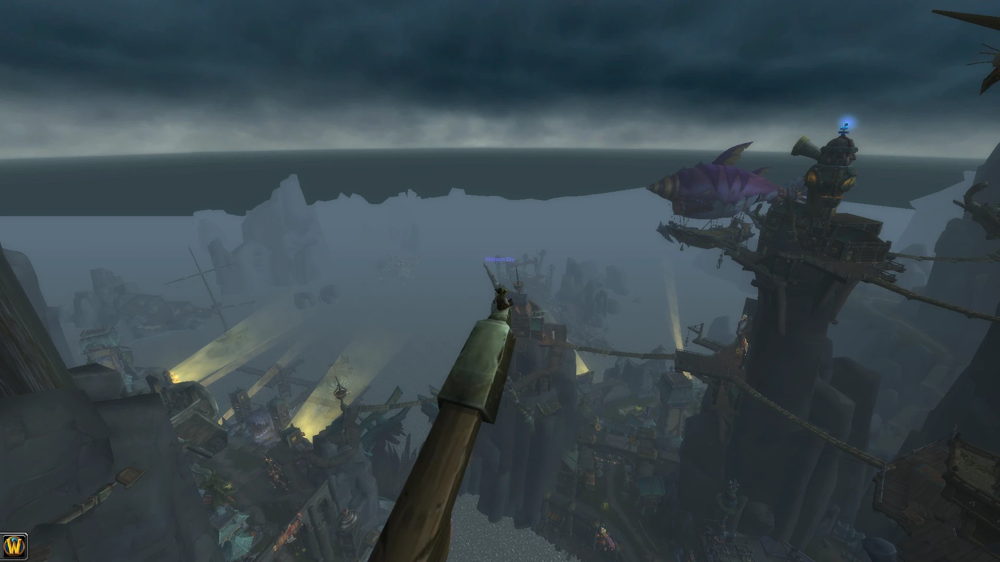

# Fading Islands Restore

Restores the Fading Island (map 907) for a WoW 3.3.5a / CoA server:

- **2 working boats** – Booty Bay <-> Hardluck and Ratchet <-> Hardluck (goblin ships, GO 9900101 / 9900102, taxi paths 2001 / 2002)
- **Working elevator** (GO 9900110, path 2003) replacing the static Noggit doodad
- **Goblin passenger NPCs on the boats** (party outfits, random dance/emotes/voices). No allied or hostile NPCs on the island itself
- **Map edits** (29 ADT tiles) with the missing-texture cubes and floating blocks removed
- **All teleport points** for map 907 (32 `game_tele` rows)
- Scripts used to generate everything (`tools/`)

This repo holds only the Fading Island work, not the client or the server.

## Layout
| Path | Content |
|---|---|
| `map/world/maps/azzararchipelago/` | edited ADT tiles |
| `server/dbc/` | `TaxiPath.dbc`, `TaxiPathNode.dbc` (server copy) |
| `server/sql/hardluck_ferries.sql` | boats, elevator, NPCs, SmartAI |
| `server/sql/fading_islands_teleports.sql` | map 907 teleports |
| `server/core-patches/` | two small core patches (see below) |
| `tools/`, `data/` | generator scripts (hardcoded local paths: reference only) |

## Install
Release assets: `patch-ZZZZZA.MPQ` (client) and `FadingIslandsRestore-v1.0.zip` (everything).
1. Client: put `patch-ZZZZZA.MPQ` in `Data/`. The client moves transports from its own DBC copy, so it must match the server.
2. Server: copy `server/dbc/*.dbc` into your server `dbc` folder, apply both SQL files to the world DB, apply the core patches and rebuild.
3. Restart the server; `.tele FadingIsland` to visit.

Core patches: `transport-animation-kick` (makes the custom transports start animating) and `ferry-detach-on-fall` (detaches players who fall off the ship).

## Credits / notes
jealous-sound, the CoAC team, svenbledt and Pitho.

Game assets belong to Blizzard Entertainment. scaled and fixed with the included tools..
